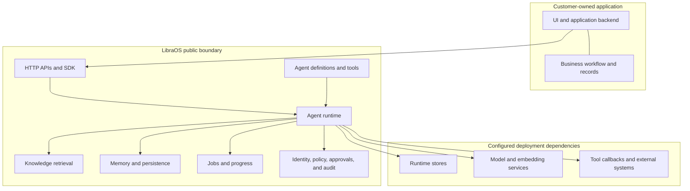

# System architecture

LibraOS is a runtime behind your application. Your application owns the user
experience, business workflow, and business records. It calls LibraOS through
the published APIs or SDK; LibraOS executes the selected agent and returns a
result, evidence, status, or approval state for the application to handle.

This is a **public-contract view**. It deliberately shows supported boundaries,
not internal services, queues, database schemas, prompts, or orchestration
algorithms.

In words: the application selects an agent and supplies authorized context. The
runtime applies that agent's configuration, retrieves permitted knowledge, uses
the configured model and tools, persists only the applicable runtime state, and
returns an observable outcome. The application remains responsible for how that
outcome changes its own business workflow.

## The boundary at a glance

| Layer | Owns | Does not own |
| --- | --- | --- |
| Your application | UI, user authentication handoff, business workflow, business records, and presentation of results or review decisions | Agent execution, retrieval implementation, or runtime persistence |
| LibraOS public interfaces | Request and response contracts, agent selection, capability reporting, and supported configuration | Your repository layout or business state machine |
| LibraOS runtime | Agent execution, configured model routing, retrieval, memory, job records, and governance results | The truth of records held in your business systems |
| Deployment dependencies | The configured database, files, models, embeddings, search, and tool endpoints | Capabilities that were not configured or are not supported by the installed release |

See [Component responsibilities](/component-responsibilities) for the detailed
ownership matrix and [Data ownership & flow](/data-ownership) for the data
classes that cross these boundaries.

## A request through the system

1. Your backend authenticates the caller and invokes an agent by the selector
   required by the chosen endpoint.
2. LibraOS resolves the installed agent definition, authorization, knowledge
   bindings, memory scope, and applicable policies.
3. The runtime uses only the model, embedding, search, and tool services that
   the deployment has configured.
4. LibraOS returns the endpoint's documented result and status fields. Your
   application decides how to display them and whether its business workflow
   should advance.

A completed agent call or job is not proof that an external action happened.
When a tool creates an approval or action record, follow that record through its
own execution result. See [Security & data boundaries](/security).

## Capability boundaries

Do not infer effective behavior from a product name or one configuration value.
Verify the installed release and its reported capabilities.

| Area | Current public boundary | Verify and continue |
| --- | --- | --- |
| Background jobs | Jobs can persist progress, events, and outcomes. Automatic restart recovery is not guaranteed for arbitrary agents or external actions. | [Run background tasks](/durable-runs) |
| Restart recovery | Automatic recovery is currently limited to the documented read-only `research_sweep` workflow when workflows are enabled. | [Restart, permissions, and retention](/durable-runs#restart-permissions-and-retention) |
| Semantic retrieval | A configured embedding model does not by itself enable semantic retrieval. Among the documented durable stores, only the SurrealDB path currently provides it. | [Knowledge base & retrieval](/knowledge-retrieval) and `GET /api/capabilities` |
| Automatic indexing | From v0.1.18, automatic indexing is opt-in. Stored documents are not necessarily indexed or retrievable. | [Scope auto-indexing](/knowledge-retrieval#scope-auto-indexing-before-you-enable-it) |
| Binary and package size | Size varies by release, platform, architecture, and package contents. | Release artifacts, checksums, and [Deployment](/deployment) |

The linked pages are the source of detailed configuration and version notes.
This page keeps only the integration consequence so those facts do not need to
be maintained in two places.

## Deployment is not processing location

Self-hosting determines where the runtime and its stores run. Configured hosted
models, embedding services, search providers, and tool callbacks can still
receive data. For an offline deployment, configure every required dependency
inside the intended boundary and verify the effective capability response. See
[Security](/security) and [Portability](/portability).

## Where to go next

- [Component responsibilities](/component-responsibilities) — what each layer
  does and explicitly does not do.
- [Data ownership & flow](/data-ownership) — which system is authoritative for
  each kind of data.
- [Customization & extension points](/customization) — supported places to
  change behavior without modifying the runtime.
- [Build on LibraOS](/build-on-libraos) — SDK, OpenAPI, clients, and examples.
